# Заявка на потребительский кредит — исполняемый BPMN-процесс в Camunda 8

Моделирование и исполнение бизнес-процесса рассмотрения кредитной заявки в **Camunda 8** с использованием **BPMN 2.0**, **DMN** и **Camunda Forms**.

Процесс **задеплоен и протестирован на движке** Camunda 8: автоматический скоринг по бизнес-правилам, ручная проверка, эскалация по SLA, подписание документов и аннулирование заявки по таймауту.

**Стек:** Camunda 8 Run (Self-Managed), Camunda Desktop Modeler, BPMN 2.0, DMN 1.3, FEEL, Camunda Forms, Operate, Tasklist.

---

## Содержание

1. [Цель процесса](#1-цель-процесса)
2. [Участники](#2-участники)
3. [Схема процесса](#3-схема-процесса)
4. [Описание шагов](#4-описание-шагов)
5. [Бизнес-правила (DMN)](#5-бизнес-правила-dmn)
6. [Переменные процесса](#6-переменные-процесса)
7. [Формы пользовательских задач](#7-формы-пользовательских-задач)
8. [SLA и обработка исключений](#8-sla-и-обработка-исключений)
9. [Тестирование](#9-тестирование)
10. [Мониторинг в Operate](#10-мониторинг-в-operate)
11. [Структура репозитория](#11-структура-репозитория)
12. [Как запустить](#12-как-запустить)
13. [Ограничения и развитие](#13-ограничения-и-развитие)

---

## 1. Цель процесса

Автоматизировать рассмотрение заявок на потребительский кредит:

- типовые заявки одобряются или отклоняются **автоматически** по формализованным правилам, без участия сотрудников;
- нетиповые (крупная сумма, малый стаж) направляются на **ручную проверку** андеррайтеру;
- просроченные проверки **эскалируются** руководителю;
- заявки, по которым клиент не подписал документы в срок, **аннулируются**.


## 2. Участники

| Участник | Роль в процессе |
|---|---|
| **Клиент** | Подаёт заявку, подписывает документы |
| **Система** | Выполняет автоматическую оценку заявки по бизнес-правилам |
| **Андеррайтер** | Проводит ручную проверку нетиповых заявок |
| **Руководитель** | Принимает решение по заявкам, проверка которых просрочена |

## 3. Схема процесса

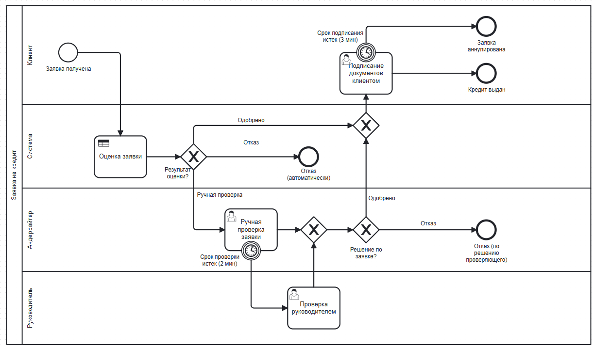


## 4. Описание шагов

| № | Элемент | Тип BPMN | Участник | Описание |
|---|---|---|---|---|
| 1 | Заявка получена | Стартовое событие | Клиент | Клиент подаёт заявку с параметрами кредита и данными о доходе |
| 2 | Оценка заявки | Business rule task (DMN) | Система | Автоматическая оценка по таблице правил `credit-scoring`, результат — в переменной `scoring` |
| 3 | Результат оценки? | Эксклюзивный шлюз | Система | Ветвление: **Одобрено** / **Отказ** / **Ручная проверка** |
| 4 | Отказ (автоматически) | Конечное событие | Система | Заявка отклонена по правилам скоринга |
| 5 | Ручная проверка заявки | User task | Андеррайтер | Андеррайтер изучает заявку и принимает решение (форма `underwriter-form`) |
| 6 | Срок проверки истек (2 мин) | Прерывающий граничный таймер | Андеррайтер | Если проверка не завершена в срок, задача снимается с андеррайтера |
| 7 | Проверка руководителем | User task | Руководитель | Эскалированная проверка (та же форма `underwriter-form`) |
| 8 | Слияние | Эксклюзивный шлюз (слияние) | Андеррайтер | Объединение веток ручной и эскалированной проверки |
| 9 | Решение по заявке? | Эксклюзивный шлюз | Андеррайтер | Ветвление по решению проверяющего: **Одобрено** / **Отказ** |
| 10 | Отказ (по решению проверяющего) | Конечное событие | Андеррайтер | Заявка отклонена сотрудником |
| 11 | Слияние | Эксклюзивный шлюз (слияние) | Система | Объединение автоматически и вручную одобренных заявок |
| 12 | Подписание документов клиентом | User task | Клиент | Подтверждение подписания документов (форма `signing-form`) |
| 13 | Срок подписания истек (3 мин) | Прерывающий граничный таймер | Клиент | Если документы не подписаны в срок — заявка аннулируется |
| 14 | Кредит выдан | Конечное событие | Клиент | Успешное завершение процесса |
| 15 | Заявка аннулирована | Конечное событие | Клиент | Завершение по таймауту подписания |

### Условия переходов

| Шлюз | Ветка | Условие (FEEL) |
|---|---|---|
| Результат оценки? | Одобрено | `=scoring = "approve"` |
| Результат оценки? | Отказ | `=scoring = "reject"` |
| Результат оценки? | Ручная проверка | `=scoring = "manual"` |
| Решение по заявке? | Одобрено | `=decision = "approve"` |
| Решение по заявке? | Отказ | `=decision = "reject"` |

## 5. Бизнес-правила (DMN)

Решение `credit-scoring`, hit policy **FIRST**.

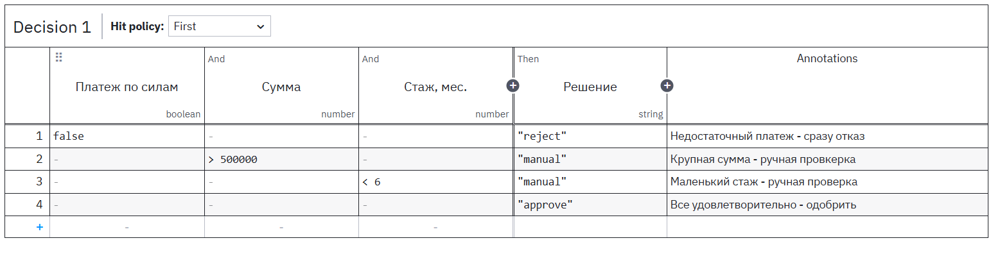

| № | Платёж по силам<br>`income * 0.4 >= amount / term` | Сумма<br>`amount` | Стаж, мес.<br>`experienceMonths` | Решение<br>`scoring` | Бизнес-смысл |
|---|---|---|---|---|---|
| 1 | `false` | – | – | `"reject"` | Ежемесячный платёж превышает 40% дохода — отказ |
| 2 | – | `> 500000` | – | `"manual"` | Крупная сумма требует ручной проверки |
| 3 | – | – | `< 6` | `"manual"` | Стаж менее 6 месяцев требует ручной проверки |
| 4 | – | – | – | `"approve"` | Остальные заявки одобряются автоматически |

**Допущение:** ежемесячный платёж считается упрощённо как `amount / term`, без учёта процентной ставки. Порог долговой нагрузки — 40% дохода.

## 6. Переменные процесса

| Переменная | Тип | Источник | Где используется | Описание |
|---|---|---|---|---|
| `clientName` | string | Заявка (старт) | Формы | ФИО клиента |
| `amount` | number | Заявка (старт) | DMN, формы | Сумма кредита, ₽ |
| `term` | number | Заявка (старт) | DMN, формы | Срок кредита, мес. |
| `income` | number | Заявка (старт) | DMN, формы | Ежемесячный доход клиента, ₽ |
| `experienceMonths` | number | Заявка (старт) | DMN | Стаж на текущем месте работы, мес. |
| `scoring` | string | Результат DMN | Шлюз «Результат оценки?» | `approve` / `manual` / `reject` |
| `decision` | string | Форма проверки | Шлюз «Решение по заявке?» | `approve` / `reject` |
| `comment` | string | Форма проверки | История экземпляра | Комментарий проверяющего |
| `documentsSigned` | boolean | Форма подписания | История экземпляра (аудит) | Факт подписания документов |

Пример входных данных заявки:

```json
{
  "clientName": "ФИО",
  "amount": 200000,
  "term": 12,
  "income": 80000,
  "experienceMonths": 24
}
```

## 7. Формы пользовательских задач

### Форма проверки (`underwriter-form`)

Используется в задачах «Ручная проверка заявки» и «Проверка руководителем».

| Поле | Тип | Key | Обязательное |
|---|---|---|---|
| Данные заявки | Text view | — | — |
| Решение | Radio (Одобрить / Отказать) | `decision` | Да |
| Комментарий | Text area | `comment` | Нет |

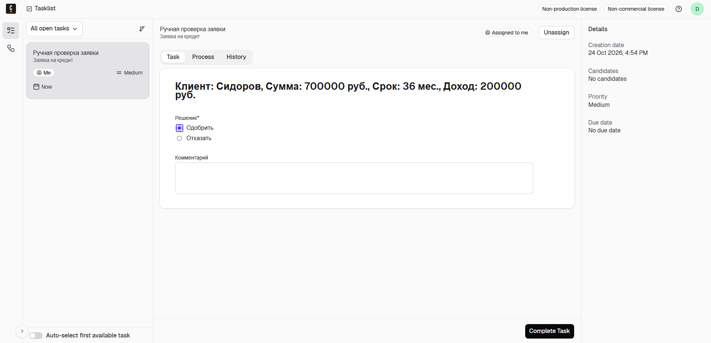

### Форма подписания (`signing-form`)

| Поле | Тип | Key | Обязательное |
|---|---|---|---|
| Данные заявки | Text view | — | — |
| Клиент подписал документы | Checkbox | `documentsSigned` | Да |

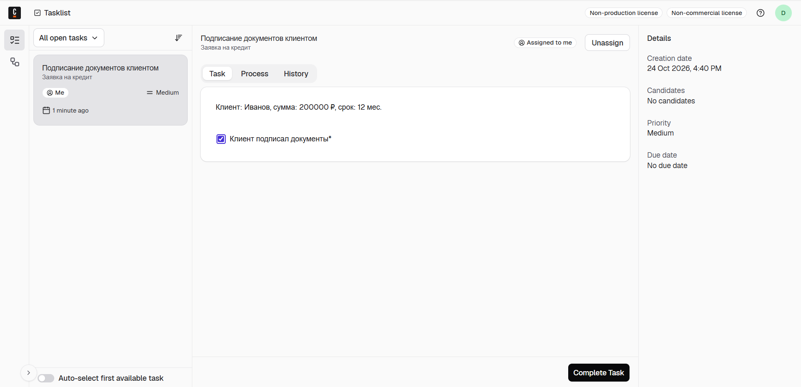

## 8. SLA и обработка исключений

| Ситуация | Механизм | Срок (демо) | Срок (в реальном процессе) | Результат |
|---|---|---|---|---|
| Андеррайтер не завершил проверку | Прерывающий граничный таймер | `PT2M` (2 мин) | `P2D` (2 дня) | Задача передаётся руководителю |
| Клиент не подписал документы | Прерывающий граничный таймер | `PT3M` (3 мин) | `P5D` (5 дней) | Заявка аннулируется |

Сроки в демо-версии сокращены до минут, чтобы проверить работу таймеров при тестировании. Длительности задаются в формате ISO 8601.

## 9. Тестирование

Тест-кейсы покрывают все ветки процесса и все конечные события.

| № | Сценарий | Входные данные | Действия в Tasklist | Результат |
|---|---|---|---|---|
| 1 | Автоодобрение | `amount=200000, term=12, income=80000, experienceMonths=24` | Подписание: отметить чекбокс | Кредит выдан |
| 2 | Автоотказ (не тянет платёж) | `amount=300000, term=6, income=20000, experienceMonths=24` | — | Отказ (автоматически) |
| 3 | Крупная сумма, одобрение | `amount=700000, term=36, income=200000, experienceMonths=24` | Проверка: «Одобрить»; подписание: отметить чекбокс | Кредит выдан |
| 4 | Малый стаж, отказ | `amount=100000, term=12, income=60000, experienceMonths=3` | Проверка: «Отказать» | Отказ (по решению проверяющего) |
| 5 | Эскалация по SLA | как в кейсе 3 | Не выполнять проверку 2+ мин, затем завершить «Проверку руководителем» | Задача передана руководителю |
| 6 | Аннулирование | как в кейсе 1 | Не выполнять подписание 3+ мин | Заявка аннулирована |

**Проверка расчёта для кейса 1:** платёж 200 000 / 12 ≈ 16 667 ₽ ≤ 40% дохода (32 000 ₽) → платёж по силам; сумма ≤ 500 000; стаж ≥ 6 мес. → правило 4 → `approve`.

## 10. Мониторинг в Operate

Прохождение каждого экземпляра проверялось в Operate: на схеме подсвечивается пройденный путь, на вкладке переменных видны данные и принятые решения.

### Автоодобрение (кейс 1)

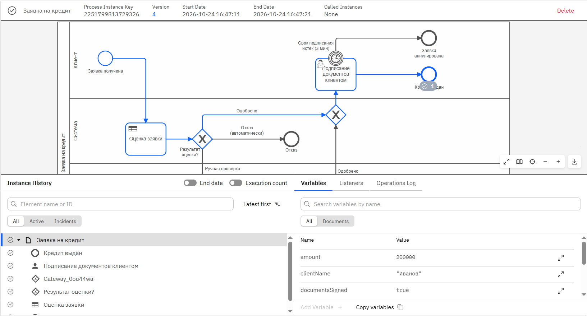

### Автоотказ (кейс 2)

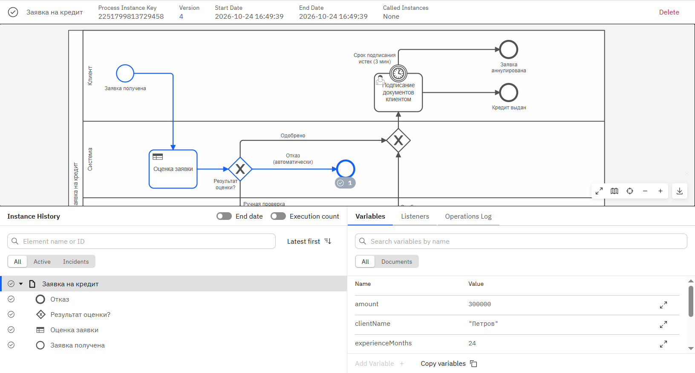

### Ручная проверка с одобрением (кейс 3)

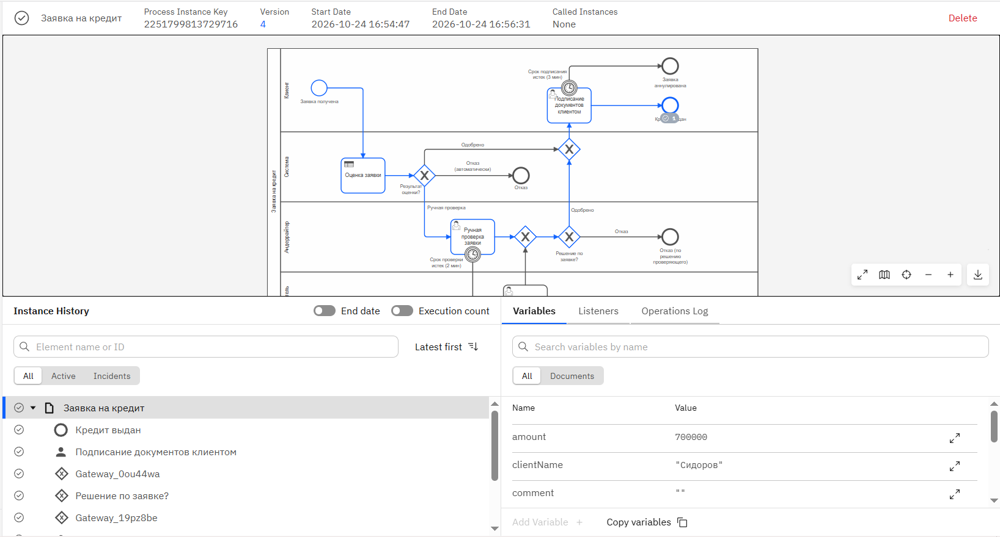

### Эскалация руководителю (кейс 5)

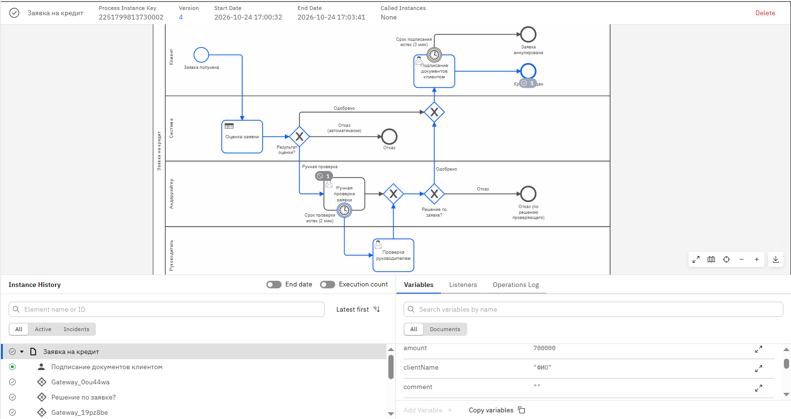

### Аннулирование заявки (кейс 6)
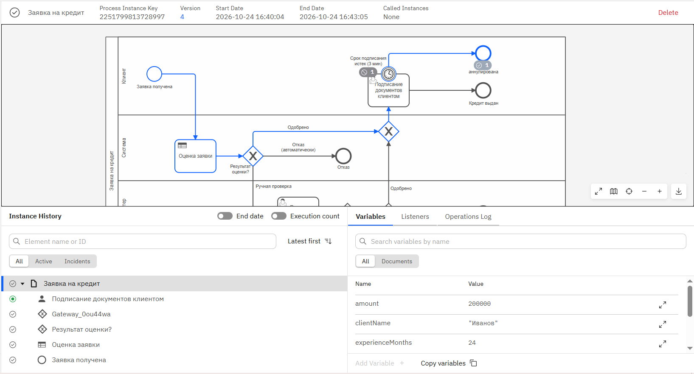

### Переменные экземпляра

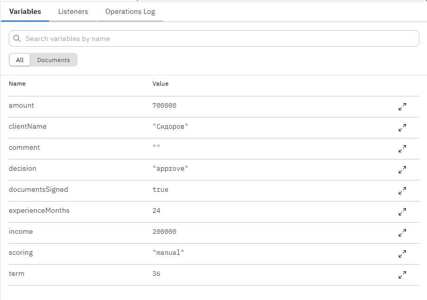

### Список экземпляров

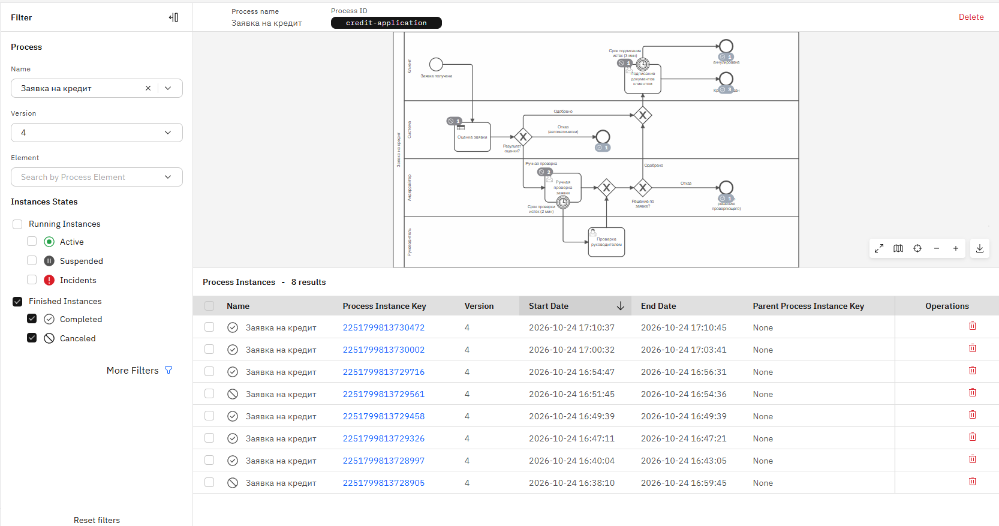

## 11. Структура репозитория

```
├── README.md
├── bpmn/
│   └── credit-application.bpmn     # модель процесса
├── dmn/
│   └── credit-scoring.dmn          # таблица решений скоринга
├── forms/
│   ├── underwriter-form.form       # форма ручной проверки
│   └── signing-form.form           # форма подписания документов
└── screenshots/                    # скриншоты из Modeler, Tasklist и Operate
```

## 12. Как запустить

1. Установить OpenJDK 21+.
2. Скачать и запустить [Camunda 8 Run](https://docs.camunda.io/docs/self-managed/quickstart/developer-quickstart/c8run/): `c8run start`.
3. Открыть файлы в [Camunda Desktop Modeler](https://camunda.com/download/modeler/) и задеплоить их на локальный кластер в порядке: `credit-scoring.dmn` → `underwriter-form.form` → `signing-form.form` → `credit-application.bpmn`.
4. Запустить экземпляр процесса из Modeler (Start instance) с входными данными в формате JSON (см. раздел 6).
5. Выполнять пользовательские задачи в Tasklist, наблюдать за экземплярами в Operate (логин / пароль: `demo` / `demo`).

## 13. Ограничения и развитие

Текущие упрощения:

- платёж рассчитывается без учёта процентной ставки;
- данные заявки передаются при запуске экземпляра, а не через клиентскую форму;
- подписание документов имитируется пользовательской задачей;
- роли (андеррайтер, руководитель) не разграничены: задачи доступны любому пользователю Tasklist.

Возможное развитие:

- расчёт аннуитетного платежа с учётом ставки в DMN;
- замена задачи подписания на **событие-сообщение** от внешней системы электронной подписи;
- назначение задач по группам (`candidateGroups`: `underwriters`, `managers`);
- непрерывающий таймер-напоминание андеррайтеру до наступления эскалации;
- аналитика сроков прохождения этапов в Camunda Optimize.
